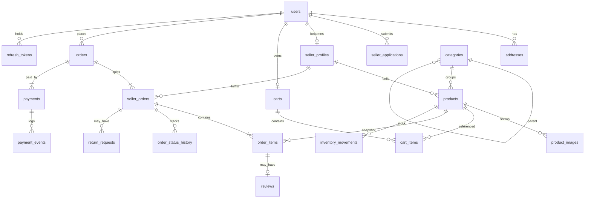

# AF-EtMart: Database Design

> Status: **design only**. No migrations or SQL have been created or run, so nothing here is verified against a database.

## 1. Conventions

- `PK` = `BIGINT GENERATED ALWAYS AS IDENTITY` unless stated.
- Money: `BIGINT` santim, currency ETB, `CHECK (>= 0)`.
- Time: `TIMESTAMPTZ`; "timestamps" = `created_at`, `updated_at` (`NOT NULL DEFAULT now()`, `updated_at` set by a shared trigger).
- Status columns are `TEXT` with `CHECK` lists.
- Columns are `NOT NULL` unless marked *null*.
- Foreign keys default to `ON DELETE RESTRICT`.
- Primary keys and unique constraints create their own indexes; others are listed.

## 2. Relationships

## 3. Multi-seller orders

**Yes, use separate seller orders (suborders).** One checkout creates one `orders` row for the customer and one `seller_orders` row per seller.

- Each seller confirms, dispatches or rejects independently.
- A seller's queries are scoped to their rows, hiding other sellers' items.
- Delivery fee, commission snapshot and cash collection belong to one seller's part.
- One rejection does not cancel the whole order.

A single order with a status per item would duplicate delivery data and make partial states and authorization harder. Trade-off: the customer may receive several deliveries and pay several times with cash on delivery, which the checkout page must say clearly.

## 4. Tables

### users
| Column | Type | Notes |
|---|---|---|
| id | PK | |
| full_name | TEXT | length 1–120 |
| email | TEXT *null* | unique index on `lower(email)` |
| phone | TEXT *null* | unique; `+251...` |
| password_hash | TEXT | never returned |
| role | TEXT | `customer`, `seller`, `admin`; default `customer` |
| status | TEXT | `active`, `suspended`, `closed`; default `active` |
| timestamps | | |

Check: email or phone present. Index: `(role, status)`.

### refresh_tokens
| Column | Type | Notes |
|---|---|---|
| id | PK | |
| user_id | BIGINT | FK users, cascade |
| family_id | UUID | rotation chain |
| token_hash | TEXT | unique |
| expires_at | TIMESTAMPTZ | |
| used_at, revoked_at | TIMESTAMPTZ *null* | |
| created_at | TIMESTAMPTZ | |

Indexes: `user_id`, `family_id`, `expires_at`.

### addresses
| Column | Type | Notes |
|---|---|---|
| id | PK | |
| user_id | BIGINT | FK users |
| recipient_name, phone | TEXT | |
| region, city | TEXT | |
| subcity, woreda, kebele, house_number | TEXT *null* | |
| landmark | TEXT | delivery directions |
| is_default | BOOLEAN | default false |
| timestamps | | |

Index: `user_id`; partial unique `(user_id) WHERE is_default`. Deletable, because orders keep a copy.

### seller_applications
| Column | Type | Notes |
|---|---|---|
| id | PK | |
| user_id | BIGINT | FK users |
| business_name, legal_name | TEXT | |
| business_phone, business_email, physical_address | TEXT | |
| tin_number, license_number | TEXT | required fields to be confirmed |
| document_keys | JSONB | private storage keys |
| status | TEXT | `pending`, `approved`, `rejected` |
| rejection_reason | TEXT *null* | required when rejected |
| reviewed_by | BIGINT *null* | FK users |
| reviewed_at | TIMESTAMPTZ *null* | |
| timestamps | | |

Indexes: `(status, created_at)`, `user_id`; partial unique `(user_id) WHERE status = 'pending'`. History is kept; reapplying creates a new row.

### seller_profiles
The seller's public store.

| Column | Type | Notes |
|---|---|---|
| id | PK | |
| user_id | BIGINT | FK users, unique |
| application_id | BIGINT | FK seller_applications, unique |
| store_name | TEXT | unique index on `lower(store_name)` |
| slug | TEXT | unique |
| description | TEXT *null* | |
| legal_name, public_phone, public_email, physical_address | TEXT | shown to buyers |
| tin_number, license_number | TEXT | publication to be legally confirmed |
| delivery_fee_santim | BIGINT | default 0; depends on delivery decision |
| status | TEXT | `active`, `suspended` |
| timestamps | | |

Index: `status`. Approval, profile creation and role change happen in one transaction.

### categories
| Column | Type | Notes |
|---|---|---|
| id | PK | |
| parent_id | BIGINT *null* | FK categories; not itself |
| name | TEXT | |
| slug | TEXT | unique |
| is_active | BOOLEAN | default true |
| timestamps | | |

Index: `parent_id`; unique sibling names (`NULLS NOT DISTINCT` on `(parent_id, name)`, PostgreSQL 15+). MVP depth limit of two is enforced by the service.

### products
| Column | Type | Notes |
|---|---|---|
| id | PK | |
| seller_id | BIGINT | FK seller_profiles |
| category_id | BIGINT | FK categories |
| name | TEXT | length 2–200 |
| slug | TEXT | unique |
| description | TEXT | |
| price_santim | BIGINT | `> 0` |
| stock_quantity | INTEGER | `>= 0` |
| status | TEXT | `draft`, `active`, `suspended`, `archived`; only an admin sets or lifts `suspended` |
| moderation_reason | TEXT *null* | |
| timestamps | | |

Indexes: `seller_id`; `(category_id, created_at DESC, id) WHERE status='active'`; `(price_santim, id) WHERE status='active'`; trigram GIN on `name` (needs `pg_trgm`; test with Amharic). Publicly visible only when the product and seller are active.

### product_images
| Column | Type | Notes |
|---|---|---|
| id | PK | |
| product_id | BIGINT | FK products, cascade |
| storage_key | TEXT | unique |
| alt_text | TEXT *null* | |
| sort_order | INTEGER | `>= 0` |
| created_at | TIMESTAMPTZ | |

Unique `(product_id, sort_order)`, deferrable for reordering.

### carts
`id` PK; `user_id` BIGINT FK users, unique, cascade; timestamps.

### cart_items
| Column | Type | Notes |
|---|---|---|
| id | PK | |
| cart_id | BIGINT | FK carts, cascade |
| product_id | BIGINT | FK products |
| quantity | INTEGER | 1–99 *(proposed)* |
| timestamps | | |

Unique `(cart_id, product_id)`; index `product_id`. No stored price: the cart shows current prices.

### orders
| Column | Type | Notes |
|---|---|---|
| id | PK | |
| order_number | TEXT | unique, random, shown to users |
| customer_id | BIGINT | FK users |
| shipping_address | JSONB | snapshot |
| payment_method | TEXT | `cod`; others when approved |
| items_total_santim, delivery_total_santim, total_santim | BIGINT | total = items + delivery |
| idempotency_key | UUID | |
| request_hash | TEXT | detects key reuse with different input |
| placed_at, updated_at | TIMESTAMPTZ | |

Unique `(customer_id, idempotency_key)`; indexes `(customer_id, placed_at DESC)`, `placed_at`. No stored status: derived from seller orders. Tax columns are deliberately absent until VAT treatment is decided.

### seller_orders
| Column | Type | Notes |
|---|---|---|
| id | PK | |
| order_id | BIGINT | FK orders |
| seller_id | BIGINT | FK seller_profiles |
| status | TEXT | `pending`, `confirmed`, `dispatched`, `delivery_failed`, `delivered`, `rejected`, `cancelled`, `returned` |
| subtotal_santim, delivery_fee_santim, total_santim | BIGINT | check total = sum |
| commission_rate_bps | INTEGER | default 0, range 0–10000; no rate decided |
| status_reason | TEXT *null* | |
| delivered_at | TIMESTAMPTZ *null* | starts the return window |
| timestamps | | |

Unique `(order_id, seller_id)` and `(id, order_id)`; indexes `(seller_id, status, created_at DESC)`, `(status, created_at)`.

### order_items
| Column | Type | Notes |
|---|---|---|
| id | PK | |
| seller_order_id | BIGINT | FK seller_orders |
| product_id | BIGINT | FK products |
| product_name | TEXT | snapshot |
| unit_price_santim | BIGINT | snapshot |
| quantity | INTEGER | `> 0` |
| line_total_santim | BIGINT | check = price × quantity |
| created_at | TIMESTAMPTZ | |

Unique `(seller_order_id, product_id)`; index `product_id`. The service guarantees the product belongs to that seller.

### order_status_history
`id` PK; `seller_order_id` FK seller_orders; `from_status` TEXT *null*; `to_status` TEXT; `changed_by` FK users *null* (system); `note` TEXT *null*; `created_at`. Index `(seller_order_id, created_at)`. Append-only.

### payments
| Column | Type | Notes |
|---|---|---|
| id | PK | |
| order_id | BIGINT | FK orders |
| seller_order_id | BIGINT *null* | with order_id, FK to seller_orders `(id, order_id)` |
| method | TEXT | |
| status | TEXT | `pending`, `paid`, `failed`, `cancelled`, `refunded` |
| amount_santim | BIGINT | `> 0` |
| provider, provider_reference | TEXT *null* | |
| paid_at | TIMESTAMPTZ *null* | |
| recorded_by | BIGINT *null* | FK users, for cash |
| timestamps | | |

Cash on delivery: one row per seller order. Online: one row per attempt for the whole order. Unique `(provider, provider_reference)`; partial unique `(seller_order_id) WHERE method='cod'`; index `order_id`. A partial online refund needs a refunds ledger, which is postponed.

### payment_events *(only with online payment)*
`id` PK; `payment_id` FK payments *null*; `provider` TEXT; `provider_event_id` TEXT; `payload` JSONB (redacted); `signature_valid` BOOLEAN; `processed_at` *null*; `created_at`. Unique `(provider, provider_event_id)`; index `payment_id`. If a provider sends no event ID, derive a deduplication key.

### return_requests
`id` PK; `seller_order_id` FK seller_orders; `customer_id` FK users; `reason` TEXT *null* (cancellation without reason is allowed); `status` TEXT (`requested`, `accepted`, `rejected`, `refunded`); `resolution_note` TEXT *null*; `refund_amount_santim` BIGINT *null*; `refunded_at` *null*; `resolved_by` FK users *null*; timestamps. Partial unique `(seller_order_id) WHERE status IN ('requested','accepted')`; index `(status, created_at)`. MVP returns cover a whole seller order; item-level returns are postponed and need legal review.

### reviews *(post-MVP)*
`id` PK; `order_item_id` FK order_items, unique; `product_id` FK products; `customer_id` FK users; `rating` SMALLINT 1–5; `comment` TEXT *null*; `status` TEXT (`visible`, `hidden`); timestamps. Index `(product_id, created_at DESC)`. Only for delivered items bought by that customer.

### inventory_movements
`id` PK; `product_id` FK products; `change` INTEGER `<> 0`; `reason` TEXT (`initial`, `adjustment`, `order`, `rejection`, `cancellation`, `return`); `seller_order_id` FK *null*; `actor_id` FK users *null*; `created_at`. Index `(product_id, created_at)`. Written in the same transaction as the stock change.

### audit_logs
`id` PK; `actor_id` FK users; `action` TEXT; `entity_type` TEXT; `entity_id` BIGINT; `details` JSONB; `created_at`. Indexes `(entity_type, entity_id)`, `(actor_id, created_at)`. Append-only.

## 5. Consistency rules

- **Inventory:** `UPDATE ... SET stock_quantity = stock_quantity - $qty WHERE id = $id AND stock_quantity >= $qty`; no updated row means rollback. Lock products in ID order.
- **Seller stock edits:** send an adjustment (+/-), not an overwrite, so concurrent sales are not lost.
- **Status changes:** update `WHERE id = $id AND status = $expected`, so a transition happens once.
- **Price:** copied into order items inside the checkout transaction.

## 6. Secure data

Hash passwords and tokens; restrict seller documents to admins; give the application a non-superuser role; redact logs and provider payloads; agree retention periods; encrypt backups.

## 7. Differences from the project skill

The `postgresql-database` skill suggests a `stores` table. This design uses `seller_profiles`, as requested, for that purpose.
