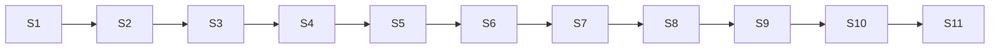

# AF-EtMart: Development Roadmap

> Status: **updated 2026-11-26, awaiting review**. Estimates are rough planning figures in person-days (pd, 8 hours), not commitments.

## 1. Capacity

Confirmed: one developer, 7 days a week, 6–7 hours a day, defense in about four weeks.

| Measure | Hours | pd |
|---|---|---|
| Capacity (28 days) | 168–196 | 21–24.5 |
| Defense release | 160 | 20 |
| Buffer | 8–36 | 1–4.5 |

At 6 hours a day the buffer is only one day, and this plan has no rest days. The full MVP (about 54 pd, section 5) does **not** fit.

## 2. Defense release plan

Dates assume work starts 27 November 2026 and the defense is about 24 December 2026. **Confirm the exact date.**

| ID | Week | Task | pd | Needs |
|---|---|---|---|---|
| S1 | 1 (27 Nov – 3 Dec) | Setup, tests, early Vercel and Render deployment | 1.5 | – |
| S2 | 1 | Database migrations and fake seed data | 1.5 | S1 |
| S3 | 1 | Login, refresh, roles, error handling, validation | 2.5 | S2 |
| S4 | 2 (4–10 Dec) | Seller application and approval (documents checked offline) | 1.5 | S3 |
| S5 | 2 | Products with one uploaded image each, stock | 3 | S4 |
| S6 | 2 | Public product list, category filter, basic search | 1.5 | S5 |
| S7 | 3 (11–17 Dec) | Cart and delivery address | 1 | S6 |
| S8 | 3 | Checkout with cash on delivery, multi-seller split, concurrency tests | 2.5 | S7 |
| S9 | 3 | Customer and seller order handling, cash record | 2 | S8 |
| S10 | 4 (18–24 Dec) | Minimal admin: suspend users, sellers, products | 0.5 | S9 |
| S11 | 4 | End-to-end tests, security checks, fixes, final deployment | 2.5 | S10 |

| Week | Planned pd | Planned hours | Available hours |
|---|---|---|---|
| 1 | 5.5 | 44 | 42–49 |
| 2 | 6 | 48 | 42–49 |
| 3 | 5.5 | 44 | 42–49 |
| 4 | 3 | 24 | 42–49 |

Week 4's spare 18–25 hours absorb earlier overflow (at 6 hours a day, weeks 1–3 overrun by 10 hours in total) and defense preparation: report, slides, demo script and rehearsal. Those preparation tasks are **not estimated**, so protect time for them.

**Checkpoints**

- **3 Dec:** login works on the deployed site.
- **10 Dec:** an approved seller publishes a product a visitor can find.
- **17 Dec:** a two-seller cash-on-delivery order works end to end. Feature freeze.
- **Before the defense:** critical flows pass on the deployed site; known limitations listed.

**If a checkpoint slips more than two days,** cut in this order: UI polish (about 1 pd), image upload replaced by image links (about 1.5 pd), then the admin suspension screens (0.5 pd). Do not cut authorization, checkout integrity or critical tests.

**Not in the defense release:** return requests, seller sales summary, category management screens, audit log screen, password change, profile editing, policy pages, multiple images, document upload and reviews. Cancelling a pending order is included in S9.

## 3. Critical path

With one developer every task is in sequence, so any delay moves everything after it.

## 4. Risks and hosting

| Risk | Effect | Mitigation |
|---|---|---|
| Illness, exams, power or internet outage | Little buffer | Push daily; cut early |
| Render free web service sleeps after 15 idle minutes; waking takes about a minute | Slow first request in the demo | Open the site a few minutes before; consider a paid instance |
| Render free Postgres expires 30 days after creation, without backups | Data loss | Create no earlier than 27 Nov, note the expiry date, keep migrations and seeds repeatable; upgrade if the defense moves or data must survive |
| Render free filesystem is erased on restart | Uploaded images vanish | External image storage (D9) |
| Cross-host login cookies | Login fails in production | Vercel rewrite of `/api` to Render, tested in week 1 |
| Checkout complexity | Overselling, duplicate orders | Concurrency tests in S8 |
| Network failure at the defense | No live demo | Run locally as backup and record a video |

### Before real customers (after the defense)

- Use **fake data only** until then.
- Confirm legally where data may be stored and processed. Proclamation 1321/2024 requires local storage of locally collected personal data in Ethiopia; this plan's foreign hosting is not assumed to comply.
- Check that your Vercel and Render plans permit commercial production use.
- Complete registration and licensing checks, return handling, policy pages, backups with a restore test, and password recovery.

## 5. Full launch MVP (reference)

The original estimate, to re-plan after the defense. Parts overlap with the defense release.

### Stage 1: Foundation (12 pd)
| ID | Task | pd | Needs |
|---|---|---|---|
| T1 | Approve documents and week 1 decisions; project setup, lint, test tools, CI | 2 | – |
| T2 | Migrations and seed data | 3 | T1 |
| T3 | Authentication, roles, error handling, validation | 3 | T2 |
| T4 | Frontend shell, layouts, shared components, auth screens, guards | 3 | T1, T3 contract |
| T5 | Early deployment of a skeleton to the chosen environment | 1 | T1 |

**M1:** register, log in and refresh work end to end in a deployed environment; CI is green.

### Stage 2: Sellers and catalog (15 pd)
| ID | Task | pd | Needs |
|---|---|---|---|
| T6 | Seller application, approval, profile (API and screens) | 3 | M1 |
| T7 | Categories | 1 | M1 |
| T8 | Product, image and stock API | 4 | T6, T7 |
| T9 | Seller product screens | 3 | T8 |
| T10 | Public listing, search, product and store pages | 4 | T8 |

**M2:** an approved seller publishes a product that a visitor can find.

### Stage 3: Buying and fulfilment (13 pd)
| ID | Task | pd | Needs |
|---|---|---|---|
| T11 | Addresses and cart | 2.5 | M2 |
| T12 | Checkout and order transaction, concurrency tests, preview and review screen | 5 | T11 |
| T13 | Customer order history and detail | 2 | T12 |
| T14 | Seller order processing and cash collection | 3.5 | T12 |

**M3 (critical):** a two-seller order is placed and fulfilled; stock tests pass. Feature freeze for anything not started.

### Stage 4: Operate, harden, release (14 pd)
| ID | Task | pd | Needs |
|---|---|---|---|
| T15 | Admin users, sellers, product moderation, orders, audit | 3 | M2 |
| T16 | Cancellation and basic returns, policy pages | 2.5 | T14 |
| T17 | Seller sales summary | 1 | T14 |
| T18 | Security review and hardening | 2 | M3 |
| T19 | End-to-end tests and bug fixing | 3 | T15–T17 |
| T20 | Production deployment, backup restore, documentation | 2.5 | T18, T19 |

**M4:** release checklist passes: critical flows, security negatives, restore test, known issues listed.

Tests are written with each task and are included in its estimate.

## 6. After the defense

Return requests and the other items left out above, hosting review, online payments, reviews, product variants, notifications, admin second factor, commissions and payouts, refunds ledger, Amharic and other languages, wishlist, courier integration and advanced search.

## Open project decisions

**Confirmed** means you stated it. Everything else is a suggestion, not approved.

| ID | Decision | Choices | Suggested or chosen | Needed by, or status |
|---|---|---|---|---|
| D1 | Team size and scope | 1, 2, 3+; full or reduced | Solo, 7 days, 6–7 hours a day. Reduced scope proposed above | Capacity confirmed |
| D2 | Payment methods | Cash on delivery; bank transfer proof; Chapa, SantimPay, ArifPay, direct telebirr | Cash on delivery only | **Confirmed** |
| D3 | Cash handling | Seller collects; platform or courier collects | Seller collects | **Confirmed** |
| D4 | Seller commission and payouts | None; percentage; flat fee; subscription | None during pilot, rate field kept | Week 2 |
| D5 | Delivery | Seller-managed; platform fleet; courier partner | Seller delivers within one city | **Confirmed** |
| D6 | Delivery fee | Free; flat per seller; by zone | Flat per seller | Week 2 |
| D7 | Languages and calendar | English; English and Amharic; more; Ethiopian calendar | English first, translatable text, Gregorian dates | Week 1 |
| D8 | Sign-in identifier and verification | Email; phone; both; OTP | Email or phone with password, no automated verification; accept the fake-account risk for a pilot | Week 1 |
| D9 | Image storage | Server disk; self-hosted object storage; managed cloud | External image service such as Cloudinary behind an adapter; check its terms | Week 2 |
| D10 | Hosting | Ethiopian provider or data centre; foreign cloud (legal conflict risk) | Frontend on Vercel, backend on Render. Database on Render Postgres is suggested, not confirmed | Frontend and backend **confirmed** for the defense; revisit before launch |
| D11 | Seller verification | Manual document check; registry integration; Fayda ID | Manual check of ID, TIN and licence | Week 1 |
| D12 | Product moderation | Before publishing; after publishing | After publishing, for approved sellers | Week 2 |
| D13 | Returns and cancellation policy | Legal minimum; more generous; per category | Legal minimum with manual refunds, lawyer-reviewed, including whether customers must be able to cancel confirmed orders themselves (the current design routes this through an admin) | Week 3 |
| D14 | Product variants | None; simple options | None; list separately | Week 1 |
| D15 | Account model | One role; multiple roles | One role; seller can also buy | Week 1 |
| D16 | Guest cart | Login required; browser cart merged later | Login required | Week 2 |
| D17 | Launch area and categories | One city; nationwide | One city (name to be chosen), few categories | City name: week 1 |
| D18 | Libraries | Zod or Joi; node-pg-migrate or Knex; TanStack Query or own hooks; test tools | Zod, node-pg-migrate, TanStack Query, Vitest, Supertest, Playwright | Week 1 |
| D19 | Tax and receipts | VAT in prices; added at checkout; seller responsibility | Ask an accountant before finalizing the schema | Week 1 |
| D20 | Email and SMS provider | None; email; SMS | None for MVP | Week 3 |
