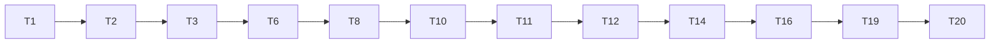

# AF-EtMart: Development Roadmap

> Status: **proposed**. Estimates are rough planning figures in person-days (pd), not commitments. Team size and start date are unknown.

## 1. Capacity check

The MVP below is estimated at **54 pd**. Four weeks give about 20 working days per full-time developer.

| Team | Capacity | Verdict |
|---|---|---|
| 1 developer | 20 pd | Does not fit, even with the cuts in section 5; extend the timeline or shrink the product |
| 2 developers | 40 pd | Does not fit without cuts |
| 3 developers | 60 pd | Possible, with little slack |

AI assistance may reduce coding time, but review, testing, decisions and external approvals still take time. Re-estimate after week 1.

## 2. Weekly plan

### Week 1: Foundation (12 pd)
| ID | Task | pd | Needs |
|---|---|---|---|
| T1 | Approve documents and week 1 decisions; project setup, lint, test tools, CI | 2 | – |
| T2 | Migrations and seed data | 3 | T1 |
| T3 | Authentication, roles, error handling, validation | 3 | T2 |
| T4 | Frontend shell, layouts, shared components, auth screens, guards | 3 | T1, T3 contract |
| T5 | Early deployment of a skeleton to the chosen environment | 1 | T1 |

**M1:** register, log in and refresh work end to end in a deployed environment; CI is green.

### Week 2: Sellers and catalog (15 pd)
| ID | Task | pd | Needs |
|---|---|---|---|
| T6 | Seller application, approval, profile (API and screens) | 3 | M1 |
| T7 | Categories | 1 | M1 |
| T8 | Product, image and stock API | 4 | T6, T7 |
| T9 | Seller product screens | 3 | T8 |
| T10 | Public listing, search, product and store pages | 4 | T8 |

**M2:** an approved seller publishes a product that a visitor can find.

### Week 3: Buying and fulfilment (13 pd)
| ID | Task | pd | Needs |
|---|---|---|---|
| T11 | Addresses and cart | 2.5 | M2 |
| T12 | Checkout and order transaction, concurrency tests, preview and review screen | 5 | T11 |
| T13 | Customer order history and detail | 2 | T12 |
| T14 | Seller order processing and cash collection | 3.5 | T12 |

**M3 (critical):** a two-seller order is placed and fulfilled; stock tests pass. Feature freeze for anything not started.

### Week 4: Operate, harden, release (14 pd)
| ID | Task | pd | Needs |
|---|---|---|---|
| T15 | Admin users, sellers, product moderation, orders, audit | 3 | M2 |
| T16 | Cancellation and basic returns, policy pages | 2.5 | T14 |
| T17 | Seller sales summary | 1 | T14 |
| T18 | Security review and hardening | 2 | M3 |
| T19 | End-to-end tests and bug fixing | 3 | T15–T17 |
| T20 | Production deployment, backup restore, documentation | 2.5 | T18, T19 |

**M4:** release checklist passes: critical flows, security negatives, restore test, known issues listed.

Tests are written with each task and are included in its estimate.

## 3. Critical path

Any slip in schema, authentication, products or checkout moves the release.

## 4. Timeline risks

| Risk | Effect | Mitigation |
|---|---|---|
| Scope exceeds capacity | Unfinished release | Agree cuts now |
| Decisions arrive late | Rework | Deadlines below |
| Payment merchant approval | Live payments not ready | Cash on delivery first |
| In-country hosting not arranged | Cannot lawfully hold real user data | Start in week 1 |
| Registration, licensing, legal review | Public launch delayed | Treat "code complete" and "public launch" as separate dates |
| Checkout complexity | Overselling, duplicate orders | Schedule it early in week 3; test concurrency |
| Testing squeezed into week 4 | Defects ship | Test per task; freeze at M3 |
| Product images and uploads | Hidden work | Limit count and size |
| No pilot sellers or real data | Wrong assumptions | Recruit in week 1 |
| One person holds key knowledge | Blocked progress | Review each other's work |

## 5. Reducing scope

| Cut or simplify | Saves about (pd) |
|---|---|
| Sales summary (T17) | 1 |
| Admin screens limited to approvals and suspension; other work through API | 1.5 |
| Single image per product, minimal seller screens | 2 |
| Seller documents checked offline, no upload | 1 |
| Flat categories seeded, no category screens | 0.5 |
| Basic search and category filter only | 1.5 |
| Shared minimal UI, polish after release | 3 |
| **Total** | **10.5** |

This leaves about 43.5 pd: still above two developers' capacity, and more than double one developer's. Solo work needs a longer timeline or a smaller product, for example a single-seller pilot first. Do not cut: server authorization, checkout integrity, critical tests, backups, or legally required cancellation handling (a manual process needs legal agreement).

Adding online payment is **extra**, roughly 5–7 pd plus provider onboarding.

## 6. After the MVP

Online payments (if not included), reviews, product variants, notifications and password reset, admin second factor, commissions and payouts, refunds ledger, item-level returns, Amharic and other languages, coupons, wishlist, courier integration, advanced search and analytics, native apps.

Self-service password reset is postponed, so agree a verified manual recovery process before launch.

## Open project decisions

None of these is approved. "Suggested" is a recommendation for the MVP.

| ID | Decision | Choices | Suggested | Needed by |
|---|---|---|---|---|
| D1 | Team size and scope | 1, 2, 3+; full or reduced | 3 developers, or cut scope | Week 1, day 1 |
| D2 | Payment methods | Cash on delivery; bank transfer proof; Chapa, SantimPay, ArifPay, direct telebirr | Cash on delivery only; start provider enquiries | Week 1 |
| D3 | Cash handling | Seller collects; platform or courier collects | Seller collects | Week 1 |
| D4 | Seller commission and payouts | None; percentage; flat fee; subscription | None during pilot, rate field kept | Week 2 |
| D5 | Delivery | Seller-managed; platform fleet; courier partner | Seller-managed, one city | Week 1 |
| D6 | Delivery fee | Free; flat per seller; by zone | Flat per seller | Week 2 |
| D7 | Languages and calendar | English; English and Amharic; more; Ethiopian calendar | English first, translatable text, Gregorian dates | Week 1 |
| D8 | Sign-in identifier and verification | Email; phone; both; OTP | Email or phone with password, no automated verification; accept the fake-account risk for a pilot | Week 1 |
| D9 | Image storage | Server disk; self-hosted object storage; managed cloud | Local disk in-country behind an adapter, backed up | Week 2 |
| D10 | Hosting | Ethiopian provider or data centre; foreign cloud (legal conflict risk) | Ethiopian-hosted VM, confirmed by legal advice | Week 1 |
| D11 | Seller verification | Manual document check; registry integration; Fayda ID | Manual check of ID, TIN and licence | Week 1 |
| D12 | Product moderation | Before publishing; after publishing | After publishing, for approved sellers | Week 2 |
| D13 | Returns and cancellation policy | Legal minimum; more generous; per category | Legal minimum with manual refunds, lawyer-reviewed, including whether customers must be able to cancel confirmed orders themselves (the current design routes this through an admin) | Week 3 |
| D14 | Product variants | None; simple options | None; list separately | Week 1 |
| D15 | Account model | One role; multiple roles | One role; seller can also buy | Week 1 |
| D16 | Guest cart | Login required; browser cart merged later | Login required | Week 2 |
| D17 | Launch area and categories | One city; nationwide | One city, few categories | Week 1 |
| D18 | Libraries | Zod or Joi; node-pg-migrate or Knex; TanStack Query or own hooks; test tools | Zod, node-pg-migrate, TanStack Query, Vitest, Supertest, Playwright | Week 1 |
| D19 | Tax and receipts | VAT in prices; added at checkout; seller responsibility | Ask an accountant before finalizing the schema | Week 1 |
| D20 | Email and SMS provider | None; email; SMS | None for MVP | Week 3 |
