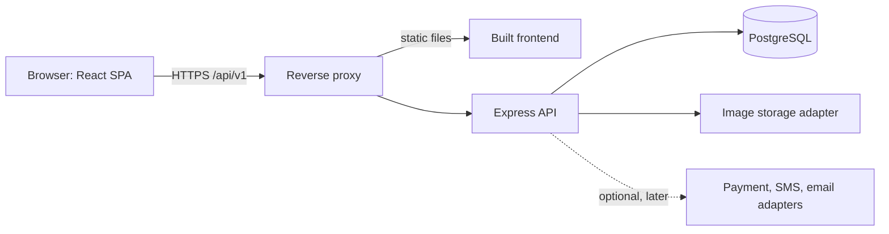
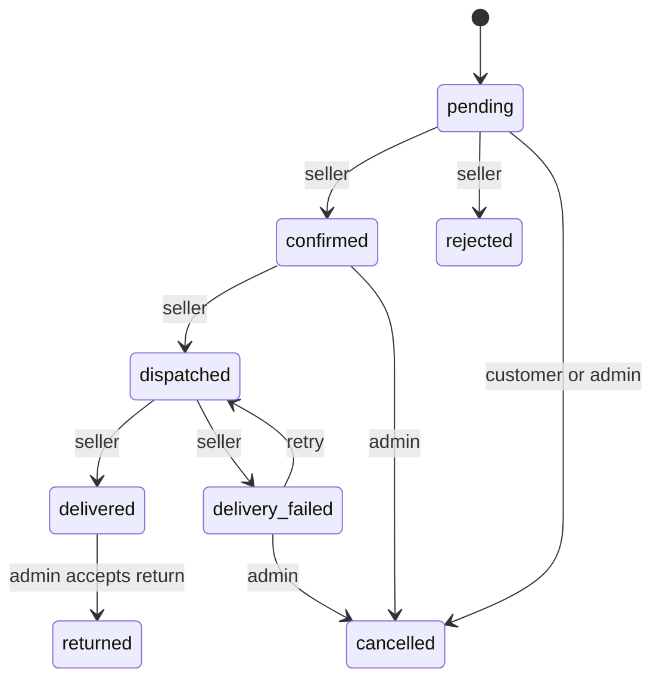

# AF-EtMart: System Architecture

> Status: **proposed, awaiting approval**. No code exists.

## 1. Overview



One single-page app and one modular API (a modular monolith). Serving both from one origin is proposed: it simplifies cookies, CORS and CSRF defence. No microservices, message queue, cache server or search service in the MVP.

## 2. Key decisions *(proposed)*

| # | Decision | Reason | Cost |
|---|---|---|---|
| A1 | Modular monolith | Fits four weeks | Scales as one unit |
| A2 | One order, one seller order per seller | Independent fulfilment, status, cash collection and access control | Extra table and status roll-up |
| A3 | Money as integer santim | No rounding errors | Convert at display |
| A4 | Stock reserved at order placement | Prevents overselling | Cancellations must restore stock |
| A5 | Access token in memory, rotating refresh cookie | Limits token theft | Refresh handling in client |
| A6 | SQL through repositories using `pg` | Transparent, few dependencies | Hand-written queries |
| A7 | Providers behind adapters | Payment and storage undecided | Small abstraction |
| A8 | Defense: Vercel frontend, Render backend, fake data only (hosts confirmed) | Fast to deploy | Hosting must be reviewed before real users (Proclamation 1321/2024 Art. 22) |

## 3. Repository layout

```
client/   React + Vite app
server/   Express API, migrations, tests
docs/
```

## 4. Backend

```
server/src/
  app.js  server.js
  config/        environment validation
  modules/
    auth/ users/ addresses/ sellers/ categories/ products/
    cart/ orders/ payments/ returns/ admin/
      routes.js controller.js service.js repository.js schema.js
  middleware/    requestId, security, rateLimit, authenticate, authorize,
                 validate, upload, notFound, errorHandler
  db/            pool, transaction helper, migrations/
  adapters/      storage/, payments/
  lib/           errors, logger, money
```

| Layer | Does | Does not |
|---|---|---|
| Routes | Map URL to middleware and controller | Logic |
| Controllers | Use validated input, call service, shape response | SQL, business rules |
| Services | Business rules, ownership, state transitions, transactions | Touch `req`/`res` |
| Repositories | Parameterized SQL | Authorization decisions |

**Request pipeline:** request ID → security headers → CORS → body limit → rate limit → authenticate → role check → validate → controller → error handler.

**Validation:** one schema library (Zod suggested) for params, query and body; unknown fields rejected.

**Errors:** typed application errors; one handler returns `{ error: { code, message, details, requestId } }`; internals are logged, never returned.

**Authentication:** see section 6. **Authorization:** role middleware, then ownership scoping in services and SQL, then state checks.

### Checkout transaction

1. Check the idempotency key; return the original order for a repeat.
2. In one transaction, lock the cart row, then its product rows in ID order.
3. Verify products and sellers are active, stock suffices, and the buyer is not the seller.
4. Compute prices and fees on the server; compare with the total the buyer reviewed.
5. Insert the order, seller orders, items with snapshots, payment records, history.
6. Decrement stock and record movements; empty the cart.
7. Commit. Call external services only after commit.

### Seller order states



`rejected`, `cancelled` and `returned` end the flow. Rejection and cancellation restore stock; failed delivery restores it only once the order is cancelled and goods are back; returns restore it only if the goods are resellable. The parent order status is derived from its seller orders.

## 5. Frontend

```
client/src/
  app/         router, providers, layouts, guards
  features/    auth, catalog, cart, checkout, orders, account, seller, admin
  components/  Button, Input, Select, Modal, Table, Pagination, states
  hooks/  lib/ (api client, money and date formatting)
```

### Pages and layouts

| Experience | Layout | Routes |
|---|---|---|
| Public and customer | `StoreLayout` | `/`, `/products`, `/products/:slug`, `/sellers/:slug`, `/cart`, `/checkout`, `/orders`, `/orders/:orderNumber`, `/account`, `/account/addresses`, `/sell`, `/policies/:name` |
| Authentication | `AuthLayout` | `/login`, `/register` |
| Seller | `SellerLayout` | `/seller`, `/seller/products`, `/seller/products/new`, `/seller/products/:id`, `/seller/orders`, `/seller/orders/:id`, `/seller/sales`, `/seller/profile` |
| Administrator | `AdminLayout` | `/admin`, `/admin/applications`, `/admin/sellers`, `/admin/users`, `/admin/products`, `/admin/categories`, `/admin/orders`, `/admin/returns`, `/admin/audit` |
| System | any | `/forbidden`, `*` (not found) |

**Components:** `ProductCard`, `ProductGrid`, `FilterBar`, `CartLine`, `OrderSummary`, `StatusBadge`, `StatusTimeline`, `ProductForm`, `ImageUploader`, `DataTable`, `ConfirmDialog`, `EmptyState`, `ErrorState`, `Skeleton`.

### State

| State | Where |
|---|---|
| Session and user | `AuthContext` |
| Server data (including cart) | A query library (TanStack Query suggested, needs approval) |
| Search, filters, page | URL |
| Forms, dialogs | Local component state |

No global state library in the MVP.

**API layer:** one `fetch` wrapper in `lib/` sets the base URL and credentials, attaches the access token, normalizes errors, and refreshes once on 401. Concurrent requests share one refresh. Coordinate refresh across tabs (for example with the Web Locks API) so rotation is not mistaken for token reuse. Each feature has its own `api.js`.

**Protected routes:** `RequireAuth` and `RequireRole` wait for session restoration before redirecting, and return users to their destination after login. These are convenience only; the API enforces access. Seller and admin routes are lazy-loaded.

**States:** every data view has loading (skeleton), empty (with next action), error (message and retry) and success. Mutations disable their button while pending.

## 6. Authentication flow

1. Login returns a 15-minute access token and sets an `HttpOnly`, `Secure`, `SameSite=Strict` refresh cookie scoped to `/api/v1/auth`.
2. Only a hash of the refresh token is stored. Each refresh rotates it; reuse revokes the token family.
3. On page load the app calls refresh to restore the session.
4. Logout, password change and suspension revoke refresh tokens. The API checks current user status on each authenticated request (acceptable at MVP scale).
5. Cookie endpoints verify the `Origin` header.

## 7. Security

| Topic | Requirement |
|---|---|
| Password hashing | Argon2id, at least 19 MiB, t=2, p=1 |
| Tokens | Pinned algorithm; verify signature, expiry, issuer, audience; secrets from environment |
| Authorization | Deny by default; role, ownership and state on the server |
| Input | Schema validation; field allow-lists |
| SQL injection | Parameterized queries; allow-listed sort and filter identifiers |
| XSS | React escaping; no raw HTML from users; Content Security Policy |
| Rate limiting | Login, register, refresh, application, upload, checkout; general limit elsewhere |
| CORS | Same origin preferred; otherwise an explicit origin list, never `*` with credentials |
| Uploads | JPEG, PNG, WebP only; check content; size and pixel limits; re-encode and strip metadata; random names. Seller documents are private, admin-only |
| Payments | Server-computed amounts; verified signatures and provider confirmation; idempotent events; no card or wallet secrets |
| Audit | Admin actions and status changes recorded |
| Operations | HTTPS, backups, redacted logs, dependency audit, 72-hour breach procedure |

## 8. Testing strategy

Tools are proposed and not installed: Vitest, React Testing Library, Supertest, Playwright.

| Layer | Coverage |
|---|---|
| Unit | Money, totals, state transitions, permission rules |
| API integration (real test database) | Success, invalid input, 401, 403, wrong owner, 404, 409 |
| Database | Migrations on empty database, constraints, rollback of failed checkout, two buyers for the last item, idempotent retry |
| Frontend | Forms, guards, loading, empty and error states, keyboard use |
| End to end | Customer purchase, seller fulfilment, admin approval, multi-seller order, return |
| Manual | 360, 768, 1280 px; slow network; accessibility; backup restore |

Run lint, tests and build in GitHub Actions on pull requests.

## 9. Deployment and operations

**Defense (hosts confirmed):** frontend on Vercel, API on Render. Render Postgres is suggested.

- Add a Vercel rewrite from `/api/*` to the Render API, so the browser sees one origin and the refresh cookie works. The "reverse proxy" in the overview is this rewrite.
- The API accepts the Vercel site's origin for cookie requests. Configure proxy trust carefully and verify that rate limiting sees real client addresses. The Render URL stays publicly reachable, so it enforces all security itself.
- Add a rewrite so client-side routes load `index.html`.
- Do not store uploads on Render's filesystem; use the storage adapter (decision D9).
- Free-tier sleep and database expiry limits are listed in the [roadmap risks](DEVELOPMENT_ROADMAP.md#4-risks-and-hosting).
- Use fake data only.

**Real launch (open):** requires legal confirmation of data location, plans that permit commercial use, separate production configuration, backups with a tested restore, error logs and a health check. Personal data would otherwise pass through and be stored on foreign services.
